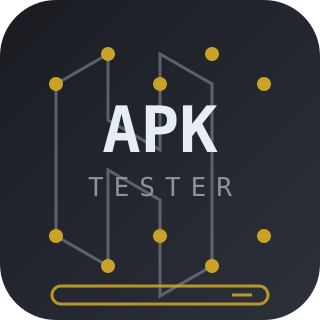

# APK Tester

<p align="center">
  
</p>

<p align="center">
  <a href=".github/workflows/ci.yml"></a>
  <a href=".github/workflows/size-gate.yml"></a>
  <a href=".github/workflows/engines-nightly.yml"></a>
  <a href=".github/workflows/apkbot.yml"></a>
  <a href="LICENSE-MIT"></a>
  <a href="GOVERNANCE.md"></a>
</p>

> **The objective is to test any program that uses APK to its absolute limits.**

**APK Tester** is the official *golden fixture* suite for
[RustyDroid](https://github.com/nadabgfccvd/RustyDroid) — the Rust runtime that
parses and executes real APKs on Linux x86_64, no VM, headless and
*agent-first* (minSdk floor 26 with structured `BELOW_FLOOR` for older targets,
a 28-language engine registry in its Apêndice G, permission engine as data, and
manifest-as-truth CORE-12). The suite produces dozens of deterministic APKs,
each with a machine-checkable *answer key*, so that
`rd inspect --json` can be numerically diffed against the contracts.

These APKs stress every layer of RustyDroid: ZIP/AXML/ARSc/DEX/ELF parsers,
the Dalvik VM, the permission engine, the component registry, the engine
detector, UI rendering, and behavior switches per targetSdk.

Portuguese documentation: [README.md](README.md) · Documentation site (mdBook):
[`docs/`](docs/) · You are reading the English version.

## What it is / what it is NOT

**It is:**

- a deterministic golden-fixture suite: generators in `tools/` (python3,
  stdlib-only, seeded), no committed binaries;
- one APK per language engine (a 32-entry matrix), a minSdk 9→36 ladder, a
  *parser-torture* pack, and the 850 MB–1 GB flagship "Behemoth";
- machine-checkable answer keys in `contracts/` for numeric diffing against
  `rd inspect --json`, engine detection, and scenario suites;
- professional repository governance on par with RustyDroid itself
  (CI, size gate, nightly compat job, mdBook docs, ADRs, templates, releases).

**It is NOT:**

- material for Google Play or any app store — these APKs are
  sideload/test fixtures and must not be installed on personal or production
  devices;
- malware: nothing here exploits or attacks systems; fixtures stress parsers
  and manifest surfaces inside controlled test environments;
- an SDK or library for end-user applications;
- a substitute for QA of real applications.

## The 5 pillars

1. **One APK per language engine** — a 32-entry matrix mirroring RustyDroid's
   28-language registry (Apêndice G), plus platform variants and the unified
   hybrid fixture (TST-14).
2. **minSdk 9 exists in the suite** — the full ladder 9→36, not just floor 26.
3. **Literally every platform permission** declared somewhere: the flagship
   declares the complete set — **1004** strings, verbatim from the AOSP
   master snapshot (including `@hide`/internal), plus appops and roles
   coverage.
4. **Heavy 3D + shaders** and a fully optimized 850 MB–1 GB flagship: size is
   content (procedural textures/meshes/audio/shaders) — never padding garbage.
5. **Professional repository governance** equal to RustyDroid itself
   (CI matrix, size gate, nightly compat job, docs site, ADRs, templates,
   releases).

## Repository layout

```
apk-tester/
├── suites/
│   ├── flagship/              # "Behemoth" — the 850MB–1GB, everything APK
│   ├── engines/               # 32 dirs, ONE APK PER ENGINE (engine-01…engine-32)
│   │   ├── engine-01-java/    # … each: real build OR detection fixture (tiered)
│   │   └── …
│   ├── sdk-ladder/            # same minimal app built at minSdk 9,12,14,16,19,21,23,26,29,33,35,36
│   └── parser-torture/        # ZIP64, v1/v2/v3-only sigs, unknown-perms, huge-arsc, obfuscated
├── tools/                     # ALL generators (python3, stdlib-only, seeded, no binaries committed)
│   ├── gen-dex-stress.py      gen-strings.py       gen-assets.py
│   ├── gen-icons.py           gen-buttons.py       gen-shaders.py
│   ├── gen-meshes.py          gen-textures.py      gen-audio.py
│   ├── fixture-pack.py        # aapt2+d8+zip packer for minSdk 9 / ZIP64 / edge fixtures
│   ├── build-variants.sh      size-budget.sh       verify-deterministic.sh
├── contracts/                 # ANSWER KEYS consumed by CI and RustyDroid
│   ├── flagship/manifest-audit.md        flagship/permissions-audit.md
│   ├── flagship/api-probe-registry.json  flagship/size-report.csv
│   ├── engines/expected-engines.json     # per-APK: engine ids RustyDroid MUST detect
│   └── suites.json                       # run_scenario suites per APK
├── docs/                      # mdBook site: guide, engine matrix, permission matrix, ADRs
├── .github/workflows/         # ci.yml, size-gate.yml, engines-nightly.yml, release.yml
├── CONTRIBUTING.md  SECURITY.md  CODE_OF_CONDUCT.md  GOVERNANCE.md  SUPPORT.md
├── README.md (PT+EN)  CHANGELOG.md  LICENSE-MIT  LICENSE-APACHE
└── scripts/compat-nightly.sh  # runs rustydroid against every fixture
```

## Engine matrix (32)

One APK per engine. Tiers: **A** = real CI builds; **B** = heavy toolchains,
gated to nightly jobs; **C** = honest synthetic detection fixtures (generated
by `tools/fixture-pack.py`; "detection fixture, payload not executable").
Details in [`suites/engines/README.md`](suites/engines/README.md).

| Directory | Language / stack | Tier | Status |
|---|---|---|---|
| `engine-01-java` | Java (DEX, multi-dex, invoke-custom) | A | **delivered (A4)** |
| `engine-02-kotlin` | Kotlin | A | **delivered (A4)** |
| `engine-03-kmp` | Kotlin Multiplatform / Compose MP | A | **delivered (A4)** |
| `engine-04-scala` | Scala | B | **delivered (A7, nightly)** |
| `engine-05-clojure` | Clojure | C | **delivered (A3)** |
| `engine-06-groovy` | Groovy | A | **delivered (A4)** |
| `engine-07-c-ndk` | C (NDK) | A | **delivered (A4)** |
| `engine-08-cpp-ndk` | C++ (NDK + STL) | A | **delivered (A4)** |
| `engine-09-rust` | Rust (cargo-ndk, JNI crate) | A | **delivered (A4)** |
| `engine-10-go` | Go (gomobile bind) | A | **delivered (A4)** |
| `engine-11-objc` | Objective-C | C | **delivered (A3)** |
| `engine-12-zig` | Zig (`zig cc` .so) | A | **delivered (A4)** |
| `engine-13-flutter` | Flutter (Dart) | B | **delivered (A7, nightly)** |
| `engine-14-react-native` | React Native (Hermes) | B | **delivered (A7, nightly)** |
| `engine-15-cordova` | Cordova (assets/www) | B | **delivered (A7, nightly)** |
| `engine-16-tauri` | Tauri v2 | A | **delivered (A4)** |
| `engine-17-nativescript` | NativeScript | B | **delivered (A7, nightly)** |
| `engine-18-maui-xamarin` | .NET MAUI / Xamarin | C | **delivered (A3)** |
| `engine-19-unity-mono` | Unity (Mono) | C | **delivered (A3)** |
| `engine-20-unity-il2cpp` | Unity (IL2CPP) | C | **delivered (A3)** |
| `engine-21-unreal` | Unreal | C | **delivered (A3)** |
| `engine-22-lua-defold` | Lua (Defold) | B | **delivered (A7, nightly)** |
| `engine-23-godot` | Godot | B | **delivered (A7, nightly)** |
| `engine-24-haxe` | Haxe | A | **delivered (A4)** |
| `engine-25-python-chaquopy` | Python (Chaquopy) | A | **delivered (A4)** |
| `engine-26-qt-qml` | Qt / QML | B | **delivered (A7, nightly)** |
| `engine-27-b4x-appinventor` | B4X / App Inventor | C | **delivered (A3)** |
| `engine-28-avalonia-dotnet` | Avalonia (.NET) | B | **delivered (A7, nightly)** |
| `engine-29-python-kivy-beeware` | Python (Kivy/BeeWare) | C | **delivered (A3)** |
| `engine-30-wasm-in-app` | WASM in-app (module + JS/JNI host) | A | **delivered (A4)** |
| `engine-31-hybrid` | Hybrid Kotlin+Rust+Hermes+WASM (TST-14) | A | **delivered (A4)** |
| `engine-32-twa-pwa` | TWA / PWA | C | **delivered (A3)** |

## Delivery phases (A0–A8)

Every phase ends compiling green. Detailed exit criteria in
[GOVERNANCE.md](GOVERNANCE.md).

| Phase | Scope | Status |
|---|---|---|
| **A0** | Repo scaffold + governance kit + CI skeletons + `tools/` generators | **delivered** |
| A1 | Flagship skeleton (probe harness, manifest-complete with EVERY permission, PermissionsHub, ButtonGrid, IconGrid) | delivered |
| A2 | `sdk-ladder` (minSdk 9 first!) + `parser-torture` pack | delivered |
| A3 | Tier C engine fixtures + `expected-engines.json` | delivered |
| **A4** | Tier A real builds (Java, Kotlin, C/C++, Rust, Go, Zig, WASM, …) | **delivered (A4)** — 14 engines with REAL builds: orchestrator `tools/build-tier-a.py` + pinned toolchains (`tools/setup-tier-a-toolchain.sh`), packaging through the same fixture-pack path and `--verify-apk` contract check (CI `tier-a-engines`, 14-job matrix) |
| **A5** | 3D/shader pillar (`:sim3d` golden + shader-library + textures/meshes/audio) | **done (A5)** — `:sim3d` engine 100% integer Q16 (perspective-correct software rasterizer, 10k-body physics, 100k CPU particles, marching cubes, skeleton animation) with byte-exact golden (`contracts/flagship/sim3d-golden.json`), Java==C++ native parity proven in CI, 239-program GLSL ES 3.1 shader-library (215 graphics + 24 compute) validated by glslang, PBR KTX2 textures + meshes (teapot/1024² terrain/50k crowd) + 5.1 audio packed into the APK (CI `flagship-3d`) |
| **A6** | Size engineering to the [850 MB, 1000 MB] gate + `size-report.csv` | **done (A6)** — "fully optimized" `modern` release (R8 full, resource shrinking with keep.xml for the 1.800 `getIdentifier` families, vcsInfo off, deterministic signing via b64 fixture keystore) + 768 MiB deterministic `gen-bulk.py` payload under `assets/bulk/` (valid KTX2/PLY/WAV + `APKT-BULK1`, sha256/synthetic manifest, full/quick presets) and the real [850, 1000] MB gate with ±2% per-category drift (`size-budget.sh --baseline`, Size Gate workflow) |
| A7 | Tier B nightly jobs + `compat-nightly` + docs site (mdBook) | delivered |
| **A8** | v1.0 gate: full matrix green, deterministic build proven, v1.0.0 release | **delivered (A8)** — `tools/v1-gate.py` evaluates the 10 Definition of Done criteria (contract `contracts/v1-gate.json`, zero-drift in CI); the `Release` workflow builds all 6 families (flagship classic+modern, Tier A 14, Tier B 9 re-verified from the green nightly, Tier C 9, ladder 12, torture 11 = 57 APKs), proves determinism with TWO consecutive modern release builds (`gradlew clean` in between, `verify-deterministic.sh --mode apk`), runs the gate with dynamic evidence and publishes the v1.0.0 release with APKs + contracts attached |

## APKBot — anti-regression bot

[APKBot](.github/workflows/apkbot.yml) is the repository's autonomous
anti-regression bot: every 6 hours (or on demand) it runs 8 checks —
determinism across runs, flakiness, staleness, engine-matrix consistency,
RustyDroid registry drift, AOSP drift, size-gate breach forecast, and
governance audit — with persistent memory in `bot/state/` and issues
deduplicated by fingerprint under the `apkbot:*` labels. Scope, limits, and
how to disable it: [GOVERNANCE.md](GOVERNANCE.md); operation:
[bot/README.md](bot/README.md).

## Hard-truths

- **minSdk 9 is below RustyDroid's floor (26):** the expected result is the
  structured error `BELOW_FLOOR(minSdk=9)` — that IS the test (error law,
  never a crash).
- **Tier C fixtures are honest:** synthetic detection targets, aligned with
  RustyDroid's own law ("detection does not validate the payload nor authorize
  execution" — ADR 003). Each Tier C fixture README states this explicitly.
- **`signature`/`@hide` permissions are unobtainable on real devices:** the
  flagship tests RustyDroid's *classification*, not device installability.
- **850 MB+ APKs are sideload-scale only** (Play base-size limit ~200 MB) —
  fine, because these are fixtures, not store products.

## Quick start: integrating with RustyDroid

```bash
# 1) Structural audit: numeric diff of inspect against the fixture answer key
rd inspect --json suites/flagship/behemoth.apk > /tmp/behemoth.json
diff /tmp/behemoth.json contracts/flagship/manifest-audit.md

# 2) Engine detector: the result MUST match the expected engine ids
rd engine detect suites/engines/engine-09-rust/*.apk \
  --expect contracts/engines/expected-engines.json

# 3) Scenario suites per APK (run_scenario)
rustydroid test contracts/suites.json
```

Note: the paths above assume artifacts built during phases A1–A4; final
contract formats and exact CLI flags are documented on the docs site
(`docs/`).

## Documentation

- [README.md](README.md) — full Portuguese version.
- [`docs/`](docs/) — mdBook site: guide, engine matrix, permission matrix,
  minSdk ladder table, RustyDroid integration guide, and ADRs
  (`docs/src/adr/`).
- [CONTRIBUTING.md](CONTRIBUTING.md) — per-tier toolchains, generators,
  commit conventions, PR checklist (Portuguese).
- [GOVERNANCE.md](GOVERNANCE.md) — roles, ADR-first process, phases A0–A8,
  versioning policy (Portuguese).
- [SECURITY.md](SECURITY.md) — vulnerability reporting and scope (Portuguese).
- [SUPPORT.md](SUPPORT.md) — where to ask and what to include (Portuguese).
- [CODE_OF_CONDUCT.md](CODE_OF_CONDUCT.md) — code of conduct (Portuguese).
- [CHANGELOG.md](CHANGELOG.md) — change history (Keep a Changelog).

## License

Dual license: **MIT OR Apache-2.0** (files
[LICENSE-MIT](LICENSE-MIT) and [LICENSE-APACHE](LICENSE-APACHE)).
`SPDX-License-Identifier: MIT OR Apache-2.0`. Fonts included in fixtures use
OFL where applicable. All contributions are licensed under the same terms —
see [CONTRIBUTING.md](CONTRIBUTING.md).
